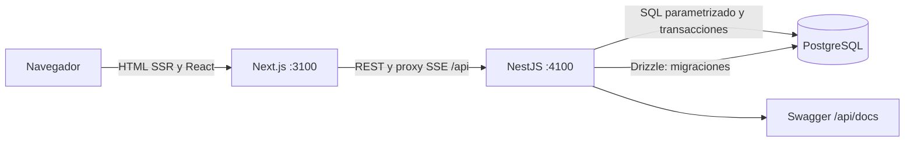

# Nexo · Mini red social

Nexo permite crear una cuenta, compartir publicaciones de texto, comentar, dar me gusta, seguir personas y consultar feeds general y personalizado. Las notificaciones de likes, comentarios y nuevos seguidores llegan mediante SSE y permanecen en PostgreSQL.

Proyecto final de Desarrollo Web · Francisco Fernando Otuc Chan.

## Estado y accesos

| Recurso | Dirección | Estado |
|---|---|---|
| Código fuente | https://github.com/Ferotuc/nexo-social | Repositorio del proyecto |
| Frontend local | http://localhost:3100 | Ejecución local |
| Backend local | http://localhost:4100/api/health | Ejecución local |
| Swagger local | http://localhost:4100/api/docs | Documentación interactiva |
| OpenAPI JSON | http://localhost:4100/api/openapi.json | Contrato generado por NestJS |
| Frontend, backend y Swagger públicos | Pendientes de proveedor de alojamiento | **No desplegados aún** |

Las direcciones localhost no son enlaces públicos de producción. El repositorio por sí solo no cumple el criterio de despliegue. El informe PDF incluido corresponde a la validación local hasta completar el alojamiento.

## Tecnologías y arquitectura

- Next.js 16, React 19 y TypeScript: frontend responsive con SSR de feed, perfiles y publicaciones; login y registro prerenderizados.
- NestJS 11: backend REST separado, validación de DTO y documentación Swagger/OpenAPI.
- PostgreSQL 17: datos relacionales, claves foráneas, restricciones e índices.
- Drizzle ORM/Kit: esquema y migraciones versionadas. La API usa SQL parametrizado con node-postgres para las consultas y transacciones.
- SSE/EventSource: invalidación del feed, contadores y notificaciones privadas en vivo.
- Docker Compose y Dockerfiles: servicios reproducibles. Versiones exactas fijadas en package-lock.json.



El navegador utiliza `/api` en el dominio del frontend. Next.js lo reenvía a la URL configurada del backend; así las cookies HttpOnly y EventSource funcionan en el mismo origen incluso cuando los servicios se alojan por separado. La API conserva su URL y Swagger públicos independientes. El origen autorizado es una lista explícita.

```text
apps/api/src/         controladores, servicio, DTO, seguridad y esquema
apps/api/drizzle/     SQL, snapshots y diario de dos migraciones
apps/web/app/         páginas SSR, login, registro y estilos
apps/web/components/ interfaz interactiva
tests/               integración real y evolución de migraciones
scripts/             arranque, persistencia y generación del informe
docs/evidence/       capturas y resultados reales
output/pdf/          informe de validación
```

## Instalación y ejecución local

Requiere Node.js 22 o superior, npm y Docker Desktop encendido. Puertos: 3100 frontend, 4100 API y 55432 PostgreSQL (solo loopback).

```powershell
git clone https://github.com/Ferotuc/nexo-social.git
cd nexo-social
Copy-Item .env.example .env
# Cambia change_me en POSTGRES_PASSWORD y DATABASE_URL por la misma clave local.
npm ci
docker compose up -d db
npm run db:migrate
npm run db:seed
npm run build
```

En dos terminales, desde la raíz:

```powershell
npm run start -w apps/api
```

```powershell
npm run start -w apps/web
```

Alternativa en Windows: `./scripts/start-local.ps1` crea un entorno local con clave aleatoria si no existe, inicia PostgreSQL, aplica migraciones, compila cuando falta el build y abre ambos procesos en segundo plano. Los registros y PIDs están en `.local/`. Si cambias el código, ejecuta `npm run build` antes de reiniciar los procesos. No uses ambos métodos a la vez.

Registra tu propia cuenta en `/register`. El seed es opcional, crea cuatro perfiles y cinco publicaciones ilustrativas solo si la base está vacía. Esos perfiles no tienen contraseñas públicas y los datos se identifican como demostración. El seed no se ejecuta automáticamente al desplegar.

### Todo con contenedores

```powershell
docker compose --profile full up -d --build
# Opcional, una sola vez si la base está vacía:
docker compose exec api node dist/db/seed.js
```

La API aplica las migraciones al arrancar. PostgreSQL usa el volumen `nexo_data`; `docker compose down` conserva los datos. Eliminar el volumen elimina la base. No usar `down -v` para reinicios normales.

## Variables de entorno

| Variable | Uso |
|---|---|
| DATABASE_URL | Conexión PostgreSQL; secreto solo del backend |
| POSTGRES_USER / POSTGRES_PASSWORD / POSTGRES_DB | Inicialización de PostgreSQL local |
| API_PORT o PORT | Puerto del backend; PORT tiene prioridad en cloud |
| WEB_ORIGIN | Orígenes frontend permitidos, separados por coma, sin `/` final |
| API_PUBLIC_URL | Origen público propio del backend para permitir Swagger desde su dominio |
| API_INTERNAL_URL | Dirección del backend vista por Next.js; también se usa al compilar las reglas de proxy |
| COOKIE_SECURE | `false` solo con HTTP local; `true` con HTTPS en producción |
| TRUST_PROXY | `true` detrás de un único proxy de confianza, como Render |

`.env` no se sube a Git. El frontend no recibe DATABASE_URL ni credenciales. Al cambiar API_INTERNAL_URL en alojamiento, reconstruir el frontend para actualizar el proxy.

## Datos y migraciones

Tablas: `users`, `sessions`, `posts`, `comments`, `likes`, `follows` y `notifications`.

- Migración `0000`: usuarios, sesiones, publicaciones e interacciones, con unicidad de email/usuario y pares like/seguimiento; prohíbe auto-seguimiento.
- Migración `0001`: agrega notificaciones persistidas, claves foráneas, restricción de tipos e índice por destinatario y fecha. No modifica ni elimina publicaciones anteriores.

```powershell
# Después de editar apps/api/src/db/schema.ts:
npm run db:generate
npm run db:migrate
```

Conservar SQL, snapshots y `meta/_journal.json` en Git. No editar una migración ya aplicada ni hacer cambios manuales de esquema. Para conexiones cloud, usar la configuración TLS exigida por el proveedor y no desactivar la verificación de certificados.

## API y documentación

Abrir `/api/docs` en frontend o backend y `/api/openapi.json` para el contrato. Incluye autenticación, usuarios, publicaciones, comentarios, interacciones, notificaciones, salud y SSE. Login/registro establecen cookie HttpOnly; Swagger permite probar acciones autenticadas desde ese mismo origen sin copiar tokens.

| Grupo | Operaciones |
|---|---|
| Autenticación | POST `/api/auth/register`, `/login`, `/logout`; GET `/api/auth/me` |
| Usuarios | GET `/api/users?q=`, GET `/api/users/:username`, PATCH `/api/users/me` |
| Seguimiento | POST/DELETE `/api/users/:id/follow` |
| Publicaciones | GET/POST `/api/posts`, GET/DELETE `/api/posts/:id` |
| Feed | GET `/api/posts?feed=general`, `?feed=following`, `?username=...`, `&page=2` |
| Likes | PUT/DELETE `/api/posts/:id/like` |
| Comentarios | GET/POST `/api/posts/:id/comments`, DELETE `/api/comments/:id` |
| Notificaciones | GET `/api/notifications`, PATCH `/api/notifications/read` |
| Tiempo real | GET `/api/events` autenticado, `text/event-stream` |

El feed devuelve hasta 15 publicaciones por página; comentarios hasta 100 por publicación y notificaciones las 50 más recientes. La búsqueda descubre hasta 12 personas por consulta. Errores coherentes: 400 datos inválidos, 401 sin sesión, 403 sin permiso, 404 inexistente, 409 duplicado, 413 tamaño excedido y 429 exceso de solicitudes.

## Seguridad y tiempo real

Contraseñas con scrypt y sal aleatoria; comparación en tiempo constante. Tokens de sesión aleatorios de 256 bits, con SHA-256 guardado en la base, expiración de siete días y revocación al cerrar sesión. Cookie HttpOnly/SameSite=Lax y Secure en producción. Validación estricta rechaza campos extra, SQL parametrizado, autorización de propietario en borrados, límites de tamaño/frecuencia, Helmet y control de origen para escrituras. React escapa el texto de los usuarios; no se acepta HTML.

Los likes y seguimientos son idempotentes. Cada mutación social y su notificación se guardan en una transacción; el evento se emite después del COMMIT. Cada usuario recibe solo invalidaciones de sus notificaciones. El frontend vuelve a pedir estado REST al conectar/reconectar, evita aplicar eventos duplicados como datos y cierra EventSource al desmontarse. Heartbeat cada 20 segundos y revisión de sesión cada minuto.

El bus SSE es de una sola instancia. Para escalar el backend a varias réplicas hay que agregar un bus compartido (Redis Pub/Sub o equivalente). Un reinicio puede perder la emisión en tránsito, pero no la notificación persistida; al reconectar se recupera desde REST. SSE evita introducir un chat innecesario para cumplir el enunciado.

## Pruebas y evidencia

Con PostgreSQL, frontend y API activos:

```powershell
npm test
npm run test:migrations
node scripts/persistence.mjs before
# Reiniciar API y PostgreSQL sin eliminar el volumen.
node scripts/persistence.mjs after
```

La integración usa dos usuarios temporales propios, comprueba hash/sesiones, permisos, REST, SSR, SSE real, unicidad e interacciones; elimina sus datos al finalizar. La prueba de migraciones crea y elimina únicamente una base temporal con prefijo `nexo_verify_`. No ejecutar estas pruebas contra producción: requieren permisos de desarrollo y borran sus fixtures.

Capturas y resultados se guardan en `docs/evidence`. El script `scripts/build-report.py` genera el informe con nombre y carné; mientras falte hosting, el documento indica claramente que la validación es local.

## Despliegue

La configuración propuesta está en [docs/DEPLOY.md](docs/DEPLOY.md) y `render.yaml`. Requiere una cuenta de alojamiento y revisar el plan elegido. GitHub almacena el repositorio, pero GitHub Pages no ejecuta NestJS ni PostgreSQL.

Antes de entregar en Canvas, sustituir el estado pendiente por las tres URLs públicas verificadas, actualizar `docs/links.json`, volver a generar el PDF y comprobar login, feed, SSE y Swagger desde otro dispositivo. No presentar las URLs locales como producción.
