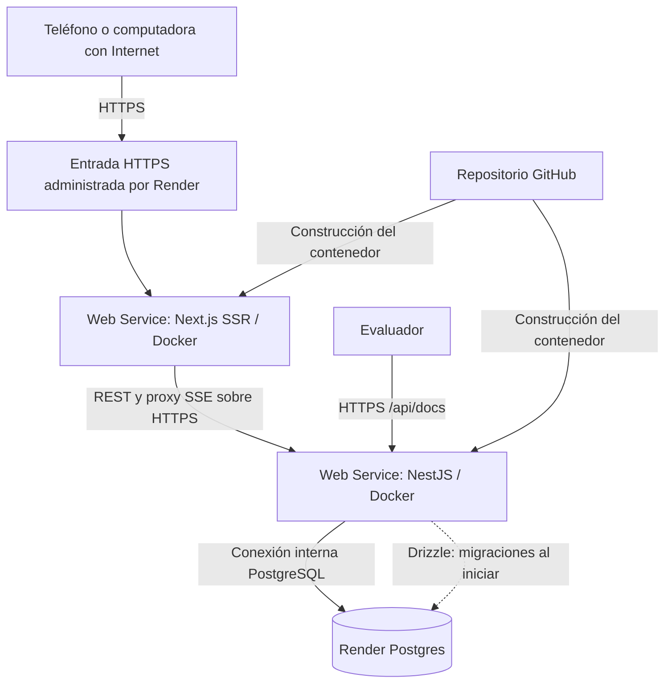

# Nexo desde otros dispositivos: arquitectura de despliegue

## Situación actual

La aplicación está desplegada y verificada en Render desde el 29 de octubre de 2026. Abre https://nexo-web-ferotuc.onrender.com desde cualquier dispositivo con Internet. Backend: https://nexo-api-ferotuc.onrender.com. Swagger: https://nexo-api-ferotuc.onrender.com/api/docs. Los servicios alojados funcionan independientemente de Docker local.

Se crearon frontend, API y PostgreSQL 17 en planes Free para la presentación, en Oregon. La base gratuita expira el 28 de noviembre de 2026. No se contrataron planes de pago.

## Arquitectura desplegada

La entrada HTTPS representa el proxy y los certificados que proporciona la plataforma; no es otro servidor que haya que contratar o instalar. La API también tiene su propia entrada HTTPS pública para Swagger y las rutas REST.

### Tres componentes alojados

| Componente       | Alojamiento                                | Responsabilidad                                                   |
| ---------------- | ------------------------------------------ | ----------------------------------------------------------------- |
| Frontend Next.js | Web Service Free con `apps/web/Dockerfile` | HTML renderizado en servidor, React, interfaz y proxy `/api`      |
| Backend NestJS   | Web Service Free con `apps/api/Dockerfile` | Autenticación, reglas, REST, Swagger y flujo SSE                  |
| PostgreSQL 17    | Render Postgres Free                       | Usuarios, sesiones, publicaciones, interacciones y notificaciones |

El frontend requiere un servicio que ejecute código de servidor porque utiliza SSR y un proxy; no se desplegará como una página estática.

## Qué se agrega y qué ya existe

Ya existen frontend, backend, base relacional, hash de contraseñas, sesiones, validación, REST, SSE, Swagger, Dockerfiles, migraciones y README. No hace falta rehacerlos.

Se agregaron los tres servicios alojados, HTTPS administrado, variables de producción y verificación externa. PostgreSQL usa almacenamiento administrado; los datos no dependen del disco efímero de los contenedores web.

Se agregó chat privado y adjuntos pequeños sin incorporar servicios adicionales. No se requiere Kubernetes, otro microservicio ni Redis para la instancia actual. El SSE actual usa una sola instancia de API; un bus compartido sería necesario si después se agregaran varias réplicas.

## Configuración de producción

| Servicio | Variable           | Valor o procedencia                                              |
| -------- | ------------------ | ---------------------------------------------------------------- |
| API      | `DATABASE_URL`     | Conexión interna configurada en Render; secreto fuera del código |
| API      | `WEB_ORIGIN`       | Origen HTTPS real del frontend, sin barra final                  |
| API      | `API_PUBLIC_URL`   | Origen HTTPS real del backend, sin barra final                   |
| API      | `NODE_ENV`         | `production`                                                     |
| API      | `COOKIE_SECURE`    | `true`                                                           |
| API      | `TRUST_PROXY`      | `true`, con el proxy de Render                                   |
| Frontend | `API_INTERNAL_URL` | URL HTTPS real de la API; disponible en build y runtime          |

En este despliegue, `API_INTERNAL_URL` apunta a la URL HTTPS pública de la API Free. No apunta al hostname privado de otro web service gratuito: Render indica que los web services Free no reciben tráfico de su red privada. PostgreSQL sí puede recibir las conexiones internas permitidas desde la API.

El navegador usa `/api` bajo el dominio del frontend; Next.js reenvía las llamadas y SSE. Así la sesión se mantiene con una cookie del mismo sitio y no necesita almacenar tokens en localStorage. CORS y el control de origen permiten únicamente los dominios configurados.

El despliegue actual usa PostgreSQL 17 y tiene todas las conexiones externas bloqueadas desde el panel de Render. La API utiliza la URL interna de la base. El Blueprint alternativo `render.yaml` reproduce esta protección con `ipAllowList: []` y `fromDatabase.connectionString`. Si se necesita administrar la base desde fuera, habrá que configurar un acceso limitado expresamente.

## Relación con los requisitos del proyecto

| Requisito académico             | Cómo lo cubre Nexo                                                                |
| ------------------------------- | --------------------------------------------------------------------------------- |
| Cliente-servidor con separación | Dos servicios y dos carpetas: Next.js y NestJS                                    |
| API REST                        | Endpoints `/api/auth`, `/api/users`, `/api/posts`, interacciones y notificaciones |
| Base relacional y migraciones   | PostgreSQL y tres migraciones versionadas con Drizzle                             |
| Registro, sesión y seguridad    | scrypt, sesión revocable, cookies, DTO, permisos y control de origen              |
| Feed, perfil y publicaciones    | Interfaz responsive con datos reales y SSR                                        |
| Interacciones sociales          | Likes, comentarios, seguimiento y chat privado                                    |
| Tiempo real                     | SSE autenticado y recuperación de notificaciones persistidas                      |
| Documentación pública           | Backend HTTPS + `/api/docs` y `/api/openapi.json`                                 |
| Contenedores                    | Dockerfile para cada aplicación                                                   |
| Despliegue público              | Frontend, API y Swagger HTTPS verificados en Render                               |
| PDF y README con enlaces        | URLs reales y capturas del despliegue público                                     |

## Recorrido para reproducir el despliegue

El despliegue actual se creó manualmente desde el repositorio público. El siguiente recorrido por Blueprint es una alternativa para otra instalación, no una tarea pendiente.

1. El usuario crea o abre su cuenta de Render con GitHub. Cualquier aceptación de términos debe realizarla el usuario.
2. Se conecta únicamente el repositorio `Ferotuc/nexo-social` y se utiliza `render.yaml` como Blueprint. Se comprueba que los tres recursos sean Free y que no se hayan agregado opciones de pago.
3. Se mantienen API y base en la misma región para la conexión interna. Se anotan las URLs que asigne la plataforma; no se inventan a partir de los nombres de servicio.
4. Se configuran `WEB_ORIGIN`, `API_PUBLIC_URL` y `API_INTERNAL_URL`. Como las URLs pueden conocerse después de crear los recursos, puede ser necesario actualizarlas y volver a desplegar. La configuración actual del Blueprint solicita esos valores; no adivinar dominios definitivos.
5. La API aplica las migraciones al iniciar. El frontend se reconstruye para que su proxy use la dirección real del backend.
6. Se prueba desde el teléfono usando datos móviles, con la computadora local apagada o los contenedores locales detenidos. La aplicación alojada debe seguir funcionando independientemente.
7. Se validan registro/login, publicación, comentarios, seguimiento, SSE entre dos sesiones y Swagger público. Se comprueba que los datos sobrevivan a un reinicio del servicio alojado.
8. Se actualizan `docs/links.json`, README y PDF con las tres URLs reales. Hasta completar esta comprobación, no se marca el proyecto como desplegado.

## Verificación realizada

El script `scripts/verify-public.mjs --after-restart` aprobó 9 comprobaciones sobre las URLs externas: salud con PostgreSQL, frontend, documentación, cookie segura, SSR, SSE entre dos sesiones, interacciones y validaciones. Tras reiniciar la API en Render, se recuperó la misma publicación con el mismo identificador. Se capturó el sitio público en escritorio y viewport móvil de 390 px. La prueba física desde un teléfono con datos móviles queda como ensayo recomendado al estudiante.

## Ampliación de chat y archivos

La tercera migración agrega `messages` y `attachments`. El backend entrega mensajes/archivos privados solo a sus participantes; SSE envía avisos después de confirmar la transacción. La presencia En línea depende de conexiones SSE activas y es aproximada. El historial y sus archivos sobreviven al reinicio; el estado de presencia se reconstruye al reconectar.

Los adjuntos se almacenan como `bytea` en PostgreSQL con límites de 2 MB por archivo, tres por envío, 20 MB por usuario y 100 MB globales. Esto evita el disco efímero de Render y basta para la presentación. Para más volumen se debe extraer el almacenamiento a un servicio de objetos conservando la autorización privada.

## Límites gratuitos para la presentación

Según la documentación de Render consultada el 29 de octubre de 2026:

- Un web service Free puede suspenderse tras 15 minutos sin tráfico; despertarlo puede tardar aproximadamente un minuto. Antes de exponer, abrir la API y el frontend y esperar a que respondan.
- El workspace comparte 750 horas gratuitas de instancias por mes. Dos servicios activos consumen horas de la misma cuota.
- PostgreSQL Free caduca 30 días después de su creación. Esta opción sirve para la demostración; no garantiza conservar la red social de forma permanente.
- Hay límites de construcción y transferencia. No agregar un método de pago ni activar servicios de pago sin revisar su impacto y sin autorización.

No se implementarán pings para eludir la suspensión. Para un servicio permanente debe elegirse un alojamiento con disponibilidad y persistencia apropiadas.

## Enlaces oficiales

- [Web services y URLs HTTPS](https://render.com/docs/web-services)
- [Planes y límites Free](https://render.com/docs/free)
- [Configuración de Blueprint y acceso a PostgreSQL](https://render.com/docs/blueprint-spec)
- [Variables de Docker durante la construcción](https://render.com/docs/docker)
